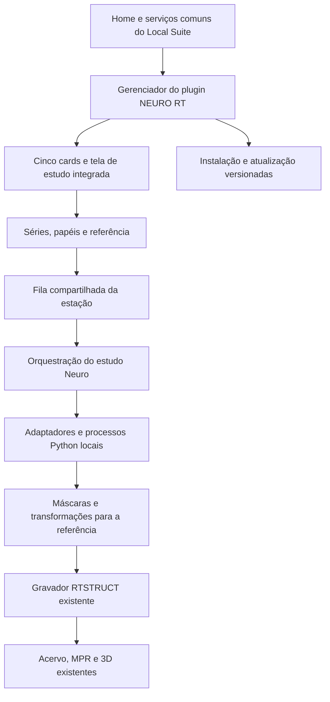

# NEURO RT — Roadmap e plano mestre de implementação

> **For agentic workers:** REQUIRED SUB-SKILL: Use superpowers:subagent-driven-development (recommended) or superpowers:executing-plans to implement this plan task-by-task. Steps use checkbox (`- [ ]`) syntax for tracking.
> **Limite desta entrega:** o usuário pediu somente documentação. A frase acima
> orienta uma execução futura; não autoriza iniciar código, criar repositórios,
> baixar pesos, instalar dependências, publicar releases ou excluir o NIDUS agora.

**Goal:** entregar o primeiro plugin opcional do Local Suite, incorporando Nidus,
segmentação tumoral e anatomia num fluxo integrado de estudo e pesquisa.

**Architecture:** distribuição independente em `Plugins/NEURO RT`, com interface,
origem, fila, configuração e visualização pertencentes ao Local Suite. O plugin
coordena adaptadores de modelos em processos locais ocultos, conserva a geometria
da série de referência e agrega as ROIs num RTSTRUCT por referência/execução.

**Tech Stack:** Python e FastAPI existentes; HTML/CSS/JavaScript e visualizadores
da suíte; PowerShell para instalação; ONNX Runtime/Raidionics, PyTorch/MONAI,
SynthSeg, ANTs e nnU-Net do host conforme cada adaptador; DICOM/SimpleITK e
gravador `engine.build_rtstruct` existentes. Versões efetivas serão fixadas após
provas de compatibilidade, não escolhidas por memória neste plano.

**Spec:** [desenho aprovado](../specs/2026-10-29-neuro-rt-plugin-local-suite-design.md).

## Global Constraints

- Desenho aceito pelo usuário em 29/10/2026; nesta etapa, somente planejamento.
- Destino instalado: `<LocalSuite>/Plugins/NEURO RT`; não usar caminhos do checkout.
- Cards: Nidus RT, Glioma RT, Metastasis RT, Meningioma RT, Anatomia RT.
- Até cinco modelos novos; QTIM pode ficar fora se a adaptação Windows não passar.
- Chaves manuais desligadas inicialmente; sem AUTO/FAST na escolha de segmentação.
- Entrada ausente desativa; classificação ambígua apenas avisa e permite executar.
- Um RTSTRUCT por série de referência/execução, ROIs separadas por modelo/classe.
- Saída completa dos modelos; sem descartar focos por tamanho por decisão da integração.
- Mesmo leitor, fila, gravador RTSTRUCT e visualizadores do Local Suite.
- A preferência global auto/CPU/GPU permanece; não confundi-la com modo de segmentação.
- Inferência solicitada pelo operador; estruturas UNAPPROVED e com procedência.
- Migração integral do Nidus; exclusão do repositório antigo somente posteriormente.
- Código/pesos/atlas com licenças compatíveis; pesos, runtimes e dados não entram no Git.
- Não ler dados clínicos privados para construir ou testar; usar sintéticos e demos permitidas.

## Review Focus

1. Duas abas pedem instalação enquanto a versão anterior trabalha: uma transação
   deve vencer, sem sobrescrever código em uso. Testes I02/I04 no plano 01.
2. Quatro volumes existem, mas a descrição de FLAIR é incerta: aviso sem bloquear,
   preservando o mapeamento efetivo; três volumes não viram quatro. Teste D02.
3. Referência oblíqua com voxel anisotrópico: MPR, 3D e RTSTRUCT devem coincidir
   no espaço físico, e não apenas ter as mesmas dimensões. Testes D03/D06.
4. Um modelo falha e outro tem ROI pequena: conclusão parcial, sem anunciar
   entrega completa nem perder a pequena ROI silenciosamente. Testes D05/D06.
5. O pacote precisa incluir um atlas NIfTI público, mas nunca imagens de pacientes:
   a permissão deve depender de procedência e lista explícita. Testes M01/R02.

---

## 1. Leitura obrigatória e ordem dos documentos

O desenho define o produto. Este roadmap define a ordem e os contratos. Os cinco
planos abaixo detalham unidades de implementação. Não interpretar caminhos ou
assinaturas propostos como arquivos já existentes.

| Documento | Responsabilidade | Tarefas |
|---|---|---|
| [01 — Plugin, instalação e integração](2026-10-29-neuro-rt-01-plugin-instalacao-integracao.md) | Descoberta, layout em disco, runtime, instalação, atualização e migração Git | I01–I05 |
| [02 — DICOM, fila e RTSTRUCT](2026-10-29-neuro-rt-02-dicom-fila-rtstruct.md) | Contratos, entradas, referência, execução, persistência e saída | D01–D07 |
| [03 — Catálogo e motores](2026-10-29-neuro-rt-03-catalogo-motores.md) | Licenças/artefatos, motores atuais e novos, Buti e catálogo efetivo | M01–M08 |
| [04 — Interface e Nidus](2026-10-29-neuro-rt-04-interface-nidus.md) | Home, cards, seleção, ajuda, progresso, visualização e migração funcional | U01–U05 |
| [05 — Validação e entregas](2026-10-29-neuro-rt-05-validacao-entregas.md) | Integração completa, empacotamento, release, recuperação e documentação | R01–R05 |

O próximo agente deve ler também `C:/AI_PROJETOS/NEURO_RT/AGENTS.md`,
`C:/AI_PROJETOS/NEURO_RT/README.md`, os arquivos necessários à sua tarefa e as
instruções do repositório que efetivamente alterará. Não reler a suíte inteira.

## 2. Visão de produto, do início ao resultado

1. A pessoa abre o Local Suite e encontra NEURO RT no lugar do antigo card Nidus.
2. Se o plugin não está instalado, a suíte explica o download e pede a confirmação
   já prevista no desenho. Recusar mantém a suíte utilizável.
3. O instalador prepara o plugin e os pesos licenciados do catálogo daquela release.
   Progresso, erro e retomada são apresentados no padrão da suíte.
4. A minipágina oferece os cinco cards. Os tumorais incluem um grupo de anatomia.
5. O seletor comum carrega a pasta/exame; o sistema encontra séries e sugere os
   papéis T1, T1 com contraste, T2 e FLAIR, sem tratar o nome como verdade absoluta.
6. A pessoa escolhe modelos e a referência. A ajuda permanece disponível mesmo
   quando uma sequência realmente ausente impede selecionar determinado modelo.
7. Ao iniciar, o pedido entra na fila comum, e o trabalho continua mesmo se a
   pessoa voltar à home. Não abrir terminais de inferência.
8. Cada motor produz máscaras com procedência; a integração as devolve à referência.
9. O gravador comum gera um RTSTRUCT contendo ROIs distintas dos modelos concluídos.
10. O visualizador mostra série selecionada, MPRs e 3D, com visibilidade por estrutura.
    A pessoa leva o resultado ao TPS para suas fusões, junções e ajustes.

O sucesso do produto se mede por esse fluxo completo, não pelo número de modelos
importáveis, pelo servidor responder HTTP 200 ou por uma imagem 3D aparecer.

## 3. Arquitetura de responsabilidades

### 3.1 O que pertence ao host

O host continua dono da aplicação web, navegação, temas, idioma, configuração,
seleção de séries, tickets de acesso, fila e arbitragem, política de atualização,
acervo, componentes de MPR/3D e gravador RTSTRUCT. A integração pequena do plugin
é distribuída pelo bundle base. Ausência ou falha do plugin não derruba a home.

### 3.2 O que pertence ao plugin

O plugin é dono do catálogo Neuro, descrição educacional dos modelos, contratos
de estudo multissequência, adaptadores, preparação específica, máscaras temporárias,
procedência, migração funcional Nidus e conteúdo das telas de estudo. Ele pede
serviços ao host por um adaptador estreito; não altera o estado global por atalhos.

### 3.3 O que pertence a cada motor

Cada motor conhece seus canais, pesos, pré-processamento, normalização, inferência,
classes e pós-processamento publicado. Recebe entradas associadas e produz máscaras
mais uma descrição verificável da geometria. Não gera RTSTRUCT, não administra
fila global e não decide quais outros modelos executar.

### 3.4 Integração visual não significa um único ambiente Python

Bibliotecas incompatíveis ficam em runtimes privados geridos pelo instalador.
O usuário percebe um app; a engenharia mantém isolamento de dependências.
Nunca atualizar pacotes do Python do host para satisfazer um motor do plugin.
Um pacote científico é carregado pelo worker apropriado, não no processo da home.

## 4. Estado atual e mudanças concretas

| Base observada | Limitação atual | Evolução planejada |
|---|---|---|
| `C:/AI_PROJETOS/NEURO_RT/neuro_rt/contracts.py` | Um `model`, uma entrada | Pedido versionado com estudos, modelos e bindings por motor |
| `C:/AI_PROJETOS/NEURO_RT/neuro_rt/catalog.py` | Validação binária de uma sequência | Requisitos por modelo e classes verificadas pelo artefato |
| `C:/AI_PROJETOS/NEURO_RT/neuro_rt/service.py` | Thread e trava locais; histórico comum só em memória | Submissão à fila comum, execução e resultados persistidos |
| `C:/AI_PROJETOS/NEURO_RT/neuro_rt/worker.py` | Uma classe final `Tumor_NeuroRT` | Adaptadores com nomes estáveis por modelo/classe |
| `C:/AI_PROJETOS/NEURO_RT/neuro_rt/export.py` | Um RTSTRUCT por job de um modelo | Agregação por referência e revisão, pelo mesmo gravador |
| `C:/AI_PROJETOS/NEURO_RT/scripts/package_module.py` | NIfTI proibido indiscriminadamente | Atlas públicos permitidos por procedência, dados de trabalho excluídos |
| `C:/AI_PROJETOS/AUTO_CONTORNO/app/radai_queue.py` | Executores `lote` e `vigia` | Registrar executor Neuro na mesma arbitragem |
| `C:/AI_PROJETOS/AUTO_CONTORNO/app/radai_atualizar.py` | Não reconhece trabalho Neuro | Mesmo diálogo, incluindo atividade do plugin |
| `C:/AI_PROJETOS/NIDUS_RT/componente.json` | Componente achatado no `app/` | Propriedade das fontes transferida ao plugin, imports sem duplicação |

## 5. Contratos planejados compartilhados

As assinaturas e nomes abaixo são decisões de planejamento, não APIs existentes.
São detalhados e implementados nas tarefas donas. Uma mudança neles exige atualizar
consumidores, testes e este contrato no mesmo conjunto de alterações.

| Contrato | Campos/garantias essenciais | Dono |
|---|---|---|
| `PluginManifest` | `id=neuro-rt`, versão, schema, host mínimo, entrada, catálogo, runtimes e artefatos | I01 |
| `PluginPaths` | raiz real do host/plugin, release ativa, modelos, runtimes, estado e dados | I01 |
| `HostServices` | adaptador de fila, dispositivo, acervo, autorização de arquivos, gravador e visores | I03 |
| `SeriesDescriptor` | ticket, UID, chave local de sujeito/estudo, modalidade, geometria e candidatos de sequência | D01 |
| `InputBinding` | `role`, `series_ticket`, certeza da classificação, origem da associação e avisos | D01/D02 |
| `ModelSpec` | ID estável, grupos, canais ordenados, referência preferida, adapter, pesos/licença/classes | M01 |
| `Eligibility` | `selectable`, `missing_roles`, `warnings`, indisponibilidade técnica separada | D02 |
| `StudyRequest` | `schema=neuro-rt/request/2`, `request_id`, `explicit_request`, lista de estudos | D01 |
| `StudyItem` | `study_id`, referência, modelos e bindings por modelo; sem mesma referência duplicada no pedido | D01 |
| `ModelRunContext` | pedido efetivo, paths privados, dispositivo resolvido, cancelamento e callback de progresso | D03/D05 |
| `ModelResult` | estado, máscaras/classes, geometria, transformações, versões, hashes e avisos | D01/M02 |
| `StudyManifest` | `schema=neuro-rt/result/2`, revisão, referência, resultados por motor, exportação e artefatos | D01/D07 |
| `StudyView` | Projeção do resultado para a UI, com IDs/tickets, rótulos, progresso e artefatos autorizados | D07 |
| `ExportReceipt` | arquivo publicado, SOPInstanceUID gerado, referência, ROIs entregues/omitidas e revisão | D06 |

Um `StudyItem` organiza vários modelos para a mesma referência. Dois conjuntos
com referências diferentes são dois itens. No resultado, cada máscara se identifica
pela dupla estável `model_id/class_id`; seus nomes exibidos podem ser traduzidos
sem mudar sua identidade. Tokens e tickets não são caminhos arbitrários do cliente.

### 5.1 Tipos auxiliares e responsabilidades

Os tipos abaixo são registros simples de contrato. A linguagem/estrutura interna
fica com o implementador; os nomes dos campos de fronteira devem permanecer iguais
entre serviços, manifestos e testes. Não precisam virar uma classe por nome.

| Tipo | Conteúdo mínimo a definir pela tarefa dona |
|---|---|
| `CompatibilityResult` — I01 | `compatible`, `required_contract`, `required_host_version`, `reason` |
| `PluginInstallation` — I01/I03 | `plugin_id`, `state`, `paths`, `manifest`, `active_version`, `reason` |
| `InstallStatus` — I02 | `transaction_id`, `state`, `stage`, `downloaded_bytes`, `total_bytes`, `reason` |
| `InstallReceipt` — I02 | `transaction_id`, `version`, `verified_artifacts`, `activation_pending` |
| `ActivationReceipt` — I02 | `previous_version`, `active_version`, `restart_required`, `status` |
| `MountReceipt` — I03 | `plugin_id`, `version`, `mounted`, `service`, `reason` |
| `ReleaseCheck` — I04 | `installed_version`, `candidate_version`, `compatible`, `asset_identity`, `status` |
| `UpdateStatus` — I04 | `transaction_id`, `state`, `stage`, `waiting_for_queue`, `reason` |
| `ArtifactReport` — M01 | `model_id`, `revision`, `status`, `verified_files`, `missing_files`, `errors` |
| `PreparedInputs` — D03 | `channel_paths`, `channel_roles`, `working_geometry`, `reference`, `transform_chain`, `cache_key` |
| `MaskArtifact` — D03 | `model_id`, `class_id`, `path`, `geometry`, `space`, `provenance` |
| `GeometryReport` — D03 | `valid`, `expected_geometry`, `actual_geometry`, `errors` |
| `QueueTicket` — D04 | `queue_id`, `request_id`, `study_id`, `executor=neuro` |
| `QueueLease` — D04 | `queue_id`, `owner`, `acquired`, registro de liberação/cancelamento |
| `ExecutionPlan` — D05 | `study_id`, `reference`, `model_steps`, `dependencies`, `selected_model_ids` |
| `RoiIdentity` — D06 | `roi_key`, `roi_name`, `description`, `color`, `model_id`, `class_id` |
| `RoiCollection` — D06 | `reference`, `rois`, `requested_models`, `failed_models`, `empty_models` |
| `AuthorizedArtifact` — D07 | `artifact_id`, `resolved_path`, `media_type`, `download_name`; path só no servidor |
| `ReleaseArtifacts` — R02 | `version`, `manifest_path`, `files`, `catalog_ids`, `source_revision` |
| `ReleaseVerification` — R02 | `valid`, `hash_results`, `license_results`, `excluded_files`, `errors` |

`RawPrediction` é interno a cada adapter e pode variar; só atravessa a fronteira
do motor depois de convertido para `ModelResult`. `AdapterFactory` é uma entrada
do registry local, não nome de função recebido livremente do cliente.
`StudyView` não inclui logs privados, paths internos ou todo o manifesto bruto;
contém a projeção autorizada no mesmo padrão do host para seleção/visualização.

### 5.2 Estados de execução e publicação

O job usa estados internos `queued`, `preparing`, `running`, `restoring`,
`exporting`, `visualizing`, `completed`, `partial`, `empty`, `failed`,
`cancelled` e `interrupted`. O adapter do host converte para a fila atual:

| Estado Neuro | Estado da fila do host | Informação mantida no detalhe |
|---|---|---|
| `queued` | `esperando` | Referência e modelos pedidos |
| Etapas de `preparing` a `visualizing` | `rodando` | Etapa e motor atuais |
| `completed` | `pronto` | Recibo e resultado íntegros |
| `empty` | `pronto` | Resultado vazio; nenhum RTSTRUCT, sem interpretação diagnóstica |
| `partial` | `parcial` | Modelos/etapas com falha, máscaras preservadas |
| `failed` ou `interrupted` | `falhou` | Causa real, interrupção identificada quando aplicável |
| `cancelled` | `cancelado` | Ato de cancelamento e resultados já existentes |

Separar estado da inferência e `export_status` (`pending`, `completed`, `empty`,
`failed`, `incomplete`). Assim, máscaras prontas não viram falsa confirmação de
publicação. Se há saídas aproveitáveis e uma falha, o resultado é parcial; se
todas as inferências válidas estão vazias e não houve erro, é vazio; se nenhum
caminho concluiu por falha, é falho. Cancelamento explícito prevalece como estado
terminal, mantendo visíveis resultados já produzidos.

O dispositivo global é lido quando o item recebe a vez, congelado para aquele
item e registrado como preferência e dispositivo efetivo. Mudança de configuração
durante o trabalho vale para itens seguintes, evitando trocar runtime no meio da execução.

## 6. Árvore de trabalho e dependências

| Marco | Entrega verificável | Dependências | Tarefas principais |
|---|---|---|---|
| A | Baseline preservada, repos/contratos de plugin definidos | Autorização futura para executar | I01, I05, D01, M01 |
| B | Host detecta plugin; instalação/atualização recuperáveis | A | I02–I04 |
| C | Corte vertical com um modelo já existente, fila e RTSTRUCT únicos | A; integração mínima de B | D02–D07, M02, U01–U04 |
| D | Nidus migrado sem regressão | B; serviços comuns preservados | U05 |
| E | Novos motores por adaptador, testados individualmente | C; artefatos verificados | M03–M08 |
| F | Catálogo completo elegível, UX integrada, testes cruzados | C, D, E | U02–U04, R01 |
| G | Pacote e atualização instaláveis em estação limpa | F | R02–R04 |
| H | Entrega documentada e migração conferida | G | R05 |

A sequência principal é **contratos → plugin carregável → modelo existente de
ponta a ponta → novos motores → entrega**. Evitar começar pelos cinco downloads
pesados ou pela pintura dos cards: isso não prova o contrato que os une.

Há paralelismo possível depois de contratos estáveis: adaptadores de modelos
diferentes e conteúdo educacional podem evoluir independentemente. Alterações
da fila, `service.py`, `contracts.py`, exportador e manifestos exigem um dono de
integração por vez. Não atribuir simultaneamente a vários agentes o mesmo arquivo
sem divisão explícita de responsabilidade e revisão de interfaces.

## 7. Como executar uma tarefa no futuro

1. Ler o desenho, restrições globais, tarefa e interfaces consumidas; conferir a
   revisão atual dos arquivos. Preservar modificações do usuário.
2. Registrar fatos que divergiram da baseline; corrigir o plano se a mudança for
   técnica equivalente. Mudanças de produto voltam ao usuário.
3. Implementar testes de comportamento nas fronteiras importantes, observando
   a falha relevante antes de corrigir. Para mudanças apenas visuais/textuais,
   verificar no navegador em vez de escrever testes que só repetem strings.
4. Implementar a unidade de responsabilidade, executar a checagem da tarefa e
   revisar o diff. Não adicionar funcionalidade futura porque parece conveniente.
5. Produzir um commit focado quando existir Git preparado; registrar testes,
   limitações reais e revisão. Não marcar tarefa pronta apenas por ter escrito arquivos.
6. Entregar ao próximo agente artefatos, interfaces, comandos/resultados e pendências.
   Não enviar PHI, credenciais, logs privados ou pesos no contexto do handoff.

Convenção: **I** instalação; **D** dados/execução; **M** modelos; **U** interface;
**R** release/qualidade. Cada plano tem tarefas com entrega independente,
arquivos exatos propostos, interfaces e passos com caixas de acompanhamento.

## 8. Política de versões, riscos e limites

- Host, plugin, motor e pesos têm versões distintas. O manifesto liga suas versões;
  uma versão única da tela não é evidência de quais pesos rodaram.
- O atualizador consulta a release do NEURO RT. O preparador usa artefatos fixados,
  não o latest de cada autor; atualizar o plugin não muda resultados de jobs antigos.
- SHA-256 comprova identidade com o manifesto obtido, não autenticidade isolada.
  A origem deve ser o repositório configurado e autorizado, usando o fluxo do host.
- Primeiro criar/manter o repositório privado, como alinhado. Releases privadas
  não são downloads públicos: a fase privada usa acesso autorizado de quem prepara
  ou um pacote offline obtido legitimamente. Não embutir PAT/token no instalador.
  Distribuição automática a terceiros sem acesso exige decisão posterior sobre
  publicação dos artefatos ou autenticação; é condição de release, não licença para
  tornar o repositório público durante a migração.
- Não prometer suporte a Windows LTSB, CPU/GPU ou desempenho apenas porque uma
  dependência importa. Registrar a matriz realmente testada e a compatibilidade do host.
- QTIM pode ser omitido com justificativa técnica. Outros problemas de artefatos
  não devem ser escondidos nem trocados por um modelo não escolhido.
- Nenhum teste sintético, demo educacional ou licença permissiva equivale a
  validação clínica dos resultados em tumores, anatomia deformada ou TC sem contraste.

## 9. Matriz de rastreabilidade do alinhamento

| Pedido/decisão | Execução planejada | Prova |
|---|---|---|
| Instalação opcional e bundle base leve | I01–I04, R02 | Base sem pesos Neuro; plugin ausente não quebra a suíte |
| Mesmo app depois de instalado | I03, U01, U05 | Mesma origem/porta, serviços e navegação |
| Cinco cards e anatomia junto aos tumores | U01/U02 | Mesmos IDs e pesos em todos os acessos |
| Migração integral Nidus e exclusão posterior | I05/U05/R05 | Inventário e regressão antes de qualquer exclusão |
| Até cinco novidades e reutilização Buti | M01–M08 | Manifesto efetivo e artefatos verificados |
| Chaves, ausência e ambiguidade | D02/U02/U03 | Estados comportamentais equivalentes no cliente/servidor |
| Fila comum, falha parcial e atualização padrão | D04/D05/I04 | Concorrência, cancelamento e update com tarefa ativa |
| Uma referência e um RTSTRUCT | D03/D06 | Geometria física, classes, UIDs e cardinalidade dos arquivos |
| MPR, 3D e seletor da série | U04/D07 | Visores sincronizados e reabertura após reinício |
| Estudo anatômico/posição das lesões | M04–M08/U03/U04 | Anatomia e lesões no espaço escolhido, procedência visível |

## 10. Estado deste roadmap

- Desenho de produto consolidado e aceito; roadmap escrito para orientar agentes.
- Todas as tarefas de implementação abaixo permanecem não iniciadas.
- Os nomes de novos arquivos, schemas e assinaturas são contratos propostos de
  engenharia. Não constituem código já implantado.
- A próxima ação autorizada nesta conversa é entregar esta documentação.
- Só após um pedido posterior de execução se inicia o trabalho nos repositórios.
